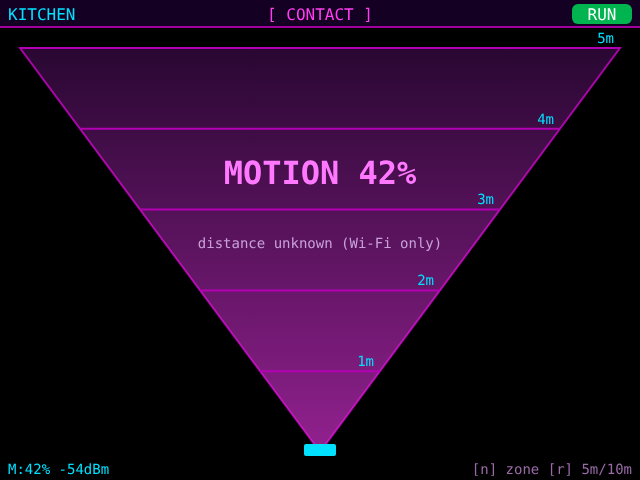
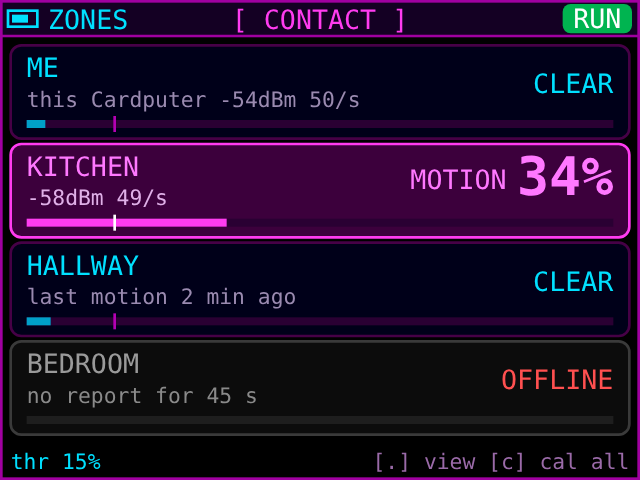
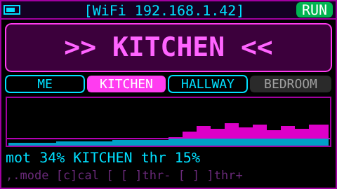
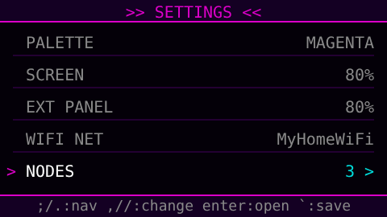
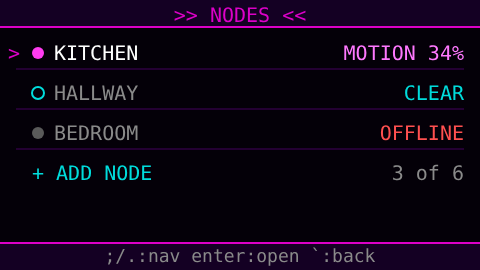
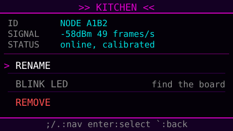
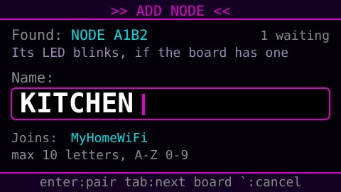
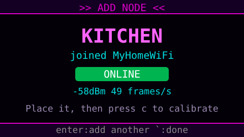

# Cardputer Human Detector — ST7789V edition

A fork of [**skizzophrenic/Cardputer-CSI-Human-Detector**](https://github.com/skizzophrenic/Cardputer-CSI-Human-Detector)
that swaps the external 2.8" ILI9341 screen for a **Waveshare 2inch LCD module (ST7789V, 240x320, IPS)**.

**All credit for the project goes to the original author** (TalkingSasquach / skizzophrenic): the
Wi-Fi CSI sensing concept, the radar scope, the raycaster view, the UI and everything else. This fork
changes the external display driver and reworks the on-device CSI signal processing (see below).
For the project's background, read the
[original README](https://github.com/skizzophrenic/Cardputer-CSI-Human-Detector#readme).
Licensed MIT, same as the original.

---

## Changes from the original

| Area | Original | This fork |
| --- | --- | --- |
| External screen | 2.8" ILI9341 (240x320) | Waveshare 2inch LCD, ST7789V (240x320, IPS) |
| Panel driver (`include/ext_panel.h`) | `Panel_ILI9341_Pork` with a custom init table, class `LGFX_ExtILI9341` | LovyanGFX `Panel_ST7789`, class `LGFX_ExtST7789`; colour inversion on (IPS), no offsets |
| Rotation | `setRotation(7)` | `setRotation(EXT_ROTATION)`, default `1` (landscape 320x240, same as the built-in screen). Use `3` to turn the picture 180° |
| Backlight | BL wired to 5V; EXT PANEL brightness dimmed by scaling every pixel of the frame | BL on **G4** with PWM; EXT PANEL brightness sets the real backlight. Pixel dimming kept as an option (`-DEXT_SOFT_DIM=1`) if BL is wired to 3V3 instead |
| Pins | defined inline | same pins, now `EXT_TFT_*` macros (overridable with `-D` flags) |
| Libraries | `M5Unified@^0.2.11` (now resolves to M5GFX 0.3.0) | pinned `M5GFX@0.2.36`, `M5Unified@0.2.29`, `M5Cardputer@1.1.1`: M5GFX 0.3.0's board detection probes G5/G6 (external CS/DC) and misdetects the Cardputer ADV |
| CSI sources | CSI from every frame on the channel (router, phones, neighbours' devices), so the measurement mostly reflected which device transmitted | only frames sent by the router the Cardputer is connected to (matched by BSSID) |
| CSI traffic | whatever traffic happened to be on the air | the Cardputer pings the gateway 50x per second, so the router sends a steady stream of frames to measure |
| CSI processing | mean raw amplitude + mean phase over all bytes; affected by the receiver's automatic gain changes | L-LTF data subcarriers only (52, present in every frame type), each frame divided by its mean amplitude to cancel gain changes; motion = per-subcarrier variance over a 0.5 s window |
| Motion scale | self-adjusting min/max: noise got stretched toward 100% in an empty room, and long motion faded into the baseline | measured against a reference: the empty-room calibration (`RUN`), or before calibration a slowly tracked quiet floor (`AUTO`) |
| Device-motion guard | moving or bumping the Cardputer showed up as false contacts | the built-in IMU (BMI270) detects when the Cardputer itself moves: sensing pauses (`MOVED`, banner `DEVICE MOVED`) until it has been still for 2 s. A bump keeps the calibration; a real relocation (tilt change over 5° or more than 1.5 s of movement) drops it and asks you to press `c` again (`MOVED:PRESS C`) |
| External screen view | round PPI radar scope; contact position (random angle, RSSI radius) did not reflect reality | **range cone**: the Cardputer at the apex, distance lines every 1 m up to 5 m, or every 2 m up to 10 m (key `r`, remembered). Motion lights up the whole cone, brighter with more motion, labelled `MOTION xx%`, because Wi-Fi sensing can't measure distance. Distance dots will come with the planned LD2410 mmWave radar. The 3D view (`.`) is unchanged |
| Status | | `NO CSI` (red) when no router frames arrive; router frames per second shown on the bottom screen footer; sensing restarts on its own after a Wi-Fi reconnect |
| Calibration (`c`) | sent `CAL` to an external sensor board that the on-device CSI build doesn't have, so nothing happened | on-device empty-room calibration: 3 s to leave the room, 10 s measurement (countdown on the bottom screen), then motion is measured against that baseline. `x` returns to `AUTO`. Not saved across reboots: recalibrate after moving the device |
| Threshold (`,` `/`) | changed the on-screen value only; detection used a fixed 0.15 | sets the real detection threshold (default 0.15, as before), saved across reboots |
| Sensor nodes | none | up to 6 ESP32-WROOM-32 / 32D boards as extra sensors, one per room (`tools/node_esp32`). Paired and named from the Cardputer's settings menu, no hardcoded names or Wi-Fi details. New **ZONES** view on the external screen; the Cardputer's own zone is called `ME`. See [Sensor nodes](#sensor-nodes) |
| CI | release workflow on `v*` tags | adds **Build firmware** workflow: builds on every push / PR / manual run and uploads the `.bin` files as artifacts (Cardputer and sensor node). Release assets `cardputer-csi-st7789v-<tag>.bin` and `csi-node-esp32-<tag>.bin` |
| Docs | | this README; `CLAUDE.md` updated for the new panel |

Unchanged: UI, rendering (240x180 canvas zoomed to 320x240), SPI bus (SPI2_HOST shared
with the SD card, 27 MHz), keyboard controls, settings, partitions, build environment.

---

## Screens

> Previews rendered from the screen designs, with example data. On the device the text uses the
> Cardputer's pixel font, so spacing differs slightly.

**External screen** (ST7789V, 320x240) — `.` switches views:

| Range cone (`n` picks the zone, `r` the scale) | Zones (Cardputer + every sensor node) |
| --- | --- |
|  |  |

**Cardputer screen** (240x135):

| Normal use, with sensor nodes | Settings (`` ` ``) |
| --- | --- |
|  |  |

**Sensor nodes** (settings → NODES):

| Node list | One node |
| --- | --- |
|  |  |
| **Add node: name it** | **Add node: paired** |
|  |  |

---

## Wiring (Cardputer ADV header → Waveshare 2inch module)

| Waveshare pin | Cardputer ADV | Notes |
| --- | --- | --- |
| DIN (MOSI) | G14 | shared with the SD card |
| CLK (SCK) | G40 | shared with the SD card |
| CS | G5 | |
| DC | G6 | |
| RST | G3 | |
| BL | G4 | backlight, software-controlled |
| VCC | 3V3 | set the module's voltage selector to 3.3V |
| GND | GND | |

---

## Flash

**Pre-built binary:** open the **Actions** tab → latest **Build firmware** run → download the
`cardputer-csi-st7789v` artifact (or take the `.bin` from a [release](../../releases)). Flash
`cardputer-csi-st7789v.bin` at address `0x0` with [ESP Web Flasher](https://esptool.spacehuhn.com/).

**From source** ([PlatformIO](https://platformio.org/)):

```sh
pio run -e cardputer-radar-csi -t upload
```

On first boot it scans for networks and asks for the password, as in the original.

---

## Keyboard controls

| Key | Action |
|-----|--------|
| `c` | Calibrate the Cardputer and every node: leave within 3 s, keep everything still for 10 s. `c` again cancels |
| `x` | Drop the calibration (Cardputer and nodes), back to `AUTO` |
| `r` | Range cone scale: 5 m (1 m lines) / 10 m (2 m lines) |
| `n` | Range cone zone: ME → each node → AUTO (follows the zone with the strongest motion) → ME. Shows the cone first if another view is open |
| `.` | External screen view: range cone → zones → 3D view |
| `,` | Decrease detection threshold (5% steps, applies to the nodes too) |
| `/` | Increase detection threshold (5% steps, applies to the nodes too) |
| `` ` `` | Open settings menu (EXT PANEL = external backlight, NODES = sensor nodes) |

---

## What it can and can't do

The Cardputer measures how the Wi-Fi signal from your router changes as it travels through the room.
It detects **motion**, best when someone moves between the Cardputer and the router, within a few
metres. It can't locate people, so the range cone shows *that* there is motion and how strong, not where. Someone sitting perfectly still stays
on the scope for about 10 s after their last movement, then disappears. Through-wall sensing is weak.

## Usage tips

- Put the Cardputer down where it will stay; moving it changes the signal far more than a person does.
  The router should be in or near the room, with the area you want to watch between the two.
- The footer shows router frames per second (`.../s`); around 50 is ideal. Below ~15 detection is
  unreliable and calibration fails.
- The status pill shows `AUTO` (uncalibrated), `CAL` (calibrating), `RUN` (calibrated),
  `MOVED` (the Cardputer itself is moving; sensing paused) or
  `NO CSI` (no router frames: the router may be ignoring pings, or it is still starting up).
- Moving the Cardputer to a new spot drops the calibration on purpose: recalibrate there.
  It doesn't recalibrate by itself, because you're usually still in the room right after moving it.
- If you pick it up during calibration, the countdown restarts once it is still again.
- Calibrate (`c`) once everything is in place. `CAL FAILED` means too few router frames or Wi-Fi dropped.
- After calibrating, an empty room should sit near 0% motion. If you get false contacts, raise the
  threshold with `/`; if you're missed, lower it with `,`.

---

## Sensor nodes

ESP32-WROOM-32 / WROOM-32D boards can act as extra sensors, one per room (up to 6). Each node joins
your Wi-Fi, pings the router and measures motion on its own link exactly like the Cardputer, then
reports to the Cardputer about 10 times a second. The Cardputer shows every room as a **zone**.

**Flash a node:** Actions tab → latest **Build firmware** run → `csi-node-esp32` artifact. Flash
`csi-node-esp32.bin` at `0x0` with [ESP Web Flasher](https://esptool.spacehuhn.com/) (or
`cd tools/node_esp32 && pio run -t upload`). Every node gets the same firmware.

**Pair it:**
1. Power the node near the Cardputer. A new node starts in setup mode (its LED blinks slowly, if the board has one).
2. On the Cardputer: `` ` `` → **NODES** → **+ ADD NODE**. The board appears as `NODE xxxx`.
3. Type a name (up to 10 letters, e.g. `KITCHEN`) and press Enter. The Cardputer sends it your Wi-Fi
   details over the air (ESP-NOW, AES-encrypted); the node saves them, joins the Wi-Fi and shows up as
   **ONLINE**. Several boards waiting at once: `tab` switches between them.
4. Put it in its room and calibrate (`c`).

**Manage nodes** (`` ` `` → **NODES**): live status of each node; open one to **RENAME** it,
**BLINK LED** to find the board, or **REMOVE** it (an online node goes back to setup mode).
Names are stored on the Cardputer only.

**Reset a board:** hold its **BOOT** button for 5 seconds → it forgets the Wi-Fi and returns to setup
mode. A freshly paired node that can't join the Wi-Fi within 60 s also returns to setup mode.

**Where to put them:** people should walk **between a node and the router**. A node right next to the
router sees little. Nodes need USB power (about 100–150 mA each).

**On screen:**
- External screen, range cone: `n` picks which zone it shows (name at the top left), or **AUTO**,
  which follows the zone with the strongest motion and stays on it until another one is clearly stronger.
- External screen, **ZONES** view (`.`): one row per zone, `ME` first. Magenta = motion above the
  threshold, `OFFLINE` when a node hasn't reported for 10 s.
- Cardputer screen: the banner names the most active zone (`>> KITCHEN <<`), chips show every zone
  (magenta = motion, outline = clear, grey = offline), the graph follows the strongest zone.
- The node's LED lights while it detects motion (handy when placing it).

**Calibration:** `c` calibrates all zones at the same time, so every watched room should be empty
for those 13 seconds.

**Security note:** the Wi-Fi password is sent once, only while you pair, encrypted with a key built
into the firmware. Because this firmware is public, someone who knows it and records that exact
moment nearby could decrypt it. To use your own key, build both firmwares with
`-DNODE_PAIR_KEY=\"16-characters!!\"` (same value on both). Node commands (calibrate, blink, remove)
are accepted from anyone on your local network.

---

## Troubleshooting

- **Picture upside down:** build with `-DEXT_ROTATION=3` (add it to `build_flags` in `platformio.ini`).
- **Colours inverted (black looks white):** set `cfg.invert = false` in `include/ext_panel.h`.
- **Red and blue swapped:** set `cfg.rgb_order = true` in `include/ext_panel.h`.
- **`NO CSI` all the time:** the router doesn't answer ping (some block ICMP from clients, or guest
  networks isolate clients). Try another network or enable ping replies on the router.
- **Node never appears in ADD NODE:** check its LED blinks slowly (setup mode); otherwise hold BOOT
  5 s. Keep it within a few metres of the Cardputer while pairing.
- **Node paired but stays `WAITING`/`OFFLINE`:** it can't reach the Wi-Fi (2.4 GHz only) or your
  network blocks broadcast between devices (guest networks / client isolation).
- **Screen stays dark:** check BL on G4; or wire BL to 3V3 and build with `-DEXT_SOFT_DIM=1`.

ST7789V settings follow the working Cardputer + Waveshare 2inch setup in
[dbgoodPQ/LauncherDual](https://github.com/dbgoodPQ/LauncherDual).
